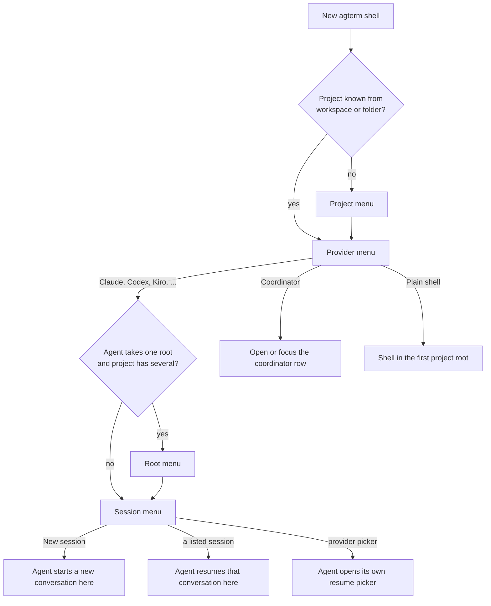

# Open, resume and find sessions

The session chooser is the main way to work with agent-utils. It opens in a new agterm
shell, asks which agent to run and whether to start a new conversation or resume one,
and then runs that agent in the same terminal. The dashboard is its counterpart for
sessions that already exist.

Before you start, describe your projects as in
[projects-and-providers.md](projects-and-providers.md).

## Open the chooser

| How | Where the agent runs |
| --- | --- |
| Open a new agterm shell (+ or Cmd-N) with the [zsh startup hook](#show-the-chooser-in-every-new-shell) on | in that shell |
| Run `agents` (or `agents agterm startup`) in an agterm shell | in that shell |
| Run `agents agterm menu --project example` anywhere | a new row in the project's agterm window and workspace |

## Walk through the chooser



1. **Project.** The chooser finds the project from the agterm workspace the shell is
   in: a workspace named like a configured project, in the window of the same name. A
   shell outside such a workspace uses its folder: the project whose root contains it
   (the deepest root wins). Otherwise it shows a **Project** menu, with **Plain shell**
   first.
2. **Provider.** One entry per visible agent CLI. The project's (or window's)
   `default_agent` comes first unless `agent_order` sets the whole order. Then:
   - **Open / resume coordinator (Claude)**, when Claude is visible. See
     [tasks-and-workers.md](tasks-and-workers.md#the-coordinator).
   - **Plain shell**: a login shell in the project's first root.
3. **Root.** [Kiro CLI](https://kiro.dev), OpenCode and Pi accept one root. For a project with several
   roots the chooser asks which one to use this time; the configuration is not changed.
4. **Session.** **New session** first. Then, for Claude, Codex and OpenCode, up to 100
   earlier conversations of this project, newest first, shown as title and id. Last:
   **Resume using provider picker** (the agent's own picker), or for Antigravity
   **Continue most recent session**. Kiro and the other agents list no sessions here;
   their own picker does it.

Every step after the first ends with **← Back**. Escape cancels; at startup that
leaves you in a plain shell. A typing filter narrows the list in the Textual and fzf
menus.

The agent then replaces the chooser in the same terminal and is registered as a managed
session (see [Session records](#session-records)). An error, for example a missing
executable or root folder, prints `Startup menu: ...` and leaves a plain shell.

A pane that agterm restored with a restart command from
[`agents agterm restore`](restore.md) skips the chooser and resumes by itself.

### `agents agterm menu`

`agents agterm menu --project example` runs the provider and session steps for an
explicit project and starts the agent in a new row. It differs from the startup
chooser: it ignores `agent_order` (default agent first, then the rest), its provider
menu has no **← Back**, and it has no root step, so give `--root` for a multi-root
project with Kiro CLI, OpenCode or Pi.

## Start or resume without a menu

```sh
agents agterm new --project hobby                       # project's default agent
agents agterm new --project example --agent kiro-cli
agents agterm new --project example --alternate         # Claude becomes Codex, any other agent Claude
agents agterm new --project example --prompt 'Read TODO.md' --name 'Parser fix'
agents agterm resume --project hobby --agent codex      # provider's picker
agents agterm resume --project example --agent claude --session CONVERSATION_ID
```

These create a new row in the project's window and workspace (made if missing). `--root`
(repeatable) replaces the roots for this launch, `--cwd` sets the starting folder and
`--name` the row title. Prefix `--dry-run` to see the `agtermctl` calls. Per-provider
resume behavior is in [projects-and-providers.md](projects-and-providers.md#provider-notes).

## Show the chooser in every new shell

Keep zsh as agterm's shell and opt in:

```sh
agents admin config run optional zsh-startup        # preview
agents admin config run optional zsh-startup --yes  # back up ~/.zshrc and add a managed block
```

The first interactive prompt of an agterm shell runs `agents agterm startup` once.
Ordinary terminals, non-interactive shells and Zellij are skipped, and launches made by
agent-utils carry `AGTERM_UTILS_PLAIN_SHELL=1` so they never show it. Existing shells
need a new session to pick it up. Undo: remove the managed block from `~/.zshrc` (or
restore the backup beside it). Do not switch agterm's restore mode for this. The older
ghostty.conf route (`agent_utils.core.setup.startup`) refuses Live mode and is discouraged.

## Put new sessions at the top

```sh
agents admin config set new_session_position top --yes
agents agterm bootstrap
```

`bootstrap` records the rows that exist now, without moving them, and creates missing
workspaces for enabled projects. After that each new row moves to the top of its
workspace once: rows made by agent-utils right after creation, ordinary +/Cmd-N rows
when the startup hook first runs. A row is moved only once, so restoring or rerunning
startup does not reorder it. Set `default` to turn it off.

## The dashboard

```sh
agents agterm dashboard                   # all windows
agents agterm dashboard --window Work --project example --all
```

One list of live rows and closed managed sessions, blocked and completed first, then
by most recent change. Each entry shows its status (`[blocked]`, `[idle]`,
`[closed · Codex]`, ...). **Refresh** takes a new snapshot; **Toggle hidden / archived**
shows the records you put away. Choosing an entry offers: focus the terminal, show the
saved record, hide or archive it, or resume a closed conversation (after you confirm
the previous agent process has ended). Status comes from agterm's agent status hooks:
install them with agterm's **Help → Install Agent Status Hooks**.

## Session records

Every session started by agent-utils has a record in
`~/.local/state/agent-utils/registry.json` with its project, agent, row id and, when
known, its conversation id. Claude launches get their id up front. For Codex and Kiro,
`agents agterm restore sync` reads it from the running agent; for others, bind it by
hand.

```sh
agents agterm session list --project example          # also --all, --compact, --live, --refresh
agents agterm session focus --record RECORD_ID
agents agterm session hide --record RECORD_ID         # out of the menus; unhide undoes
agents agterm session archive --record RECORD_ID      # unarchive undoes
agents agterm session bind --record RECORD_ID --conversation CONVERSATION_ID
agents agterm session resume --record RECORD_ID --backend-stopped
agents agterm session forget --record RECORD_ID --yes # remove only the record
```

Hide, archive and forget change only agent-utils records: no terminal is closed and no
provider history is touched. `resume` opens the saved conversation in a new row and
requires `--backend-stopped`, your confirmation that the old agent process is gone, so
two processes never write one conversation. A row that exists is not proof that the
agent started correctly; look at the terminal.

Codex conversations can also be archived or deleted in Codex itself with
`session provider-archive|provider-unarchive|provider-delete` (see
[agterm.md](../reference/agterm.md#agents-agterm-session-provider-archive)). Claude has
no such per-conversation command.

## Find earlier conversations

```sh
agents agterm history --project example --agent codex
agents agterm history --project example --agent claude --adopt CONVERSATION_ID
```

`history` lists the project's conversations from provider metadata: Codex through its
app-server API, Claude from bounded reads of its local transcript headers. `--adopt`
creates a managed record for one, so the dashboard and `session resume` know it. No
transcript is changed.

## Open the desktop app

`agents agterm gui --project example` opens Claude's desktop app (`claude --desktop`,
with `--session ID` to resume) or the Codex app in the project's first root. It does not
make the desktop app aware of the project.

## Hotkey cheatsheet

```sh
agents agterm cheatsheet --open                  # PDF if reportlab is installed, else HTML
agents agterm cheatsheet --format md --output ~/keys.md --force
```

Built from `agtermctl keymap list` and your `keymap.conf`: custom commands, leader
sequences, shared chords and actions without a shortcut. It goes to
`~/.local/state/agent-utils/cheatsheets/` by default and is never overwritten without
`--force`. It shows your personal keymap, so do not commit it. `agents configure` has it
as the action "Write the agterm hotkey cheatsheet and open it" under Projects.
