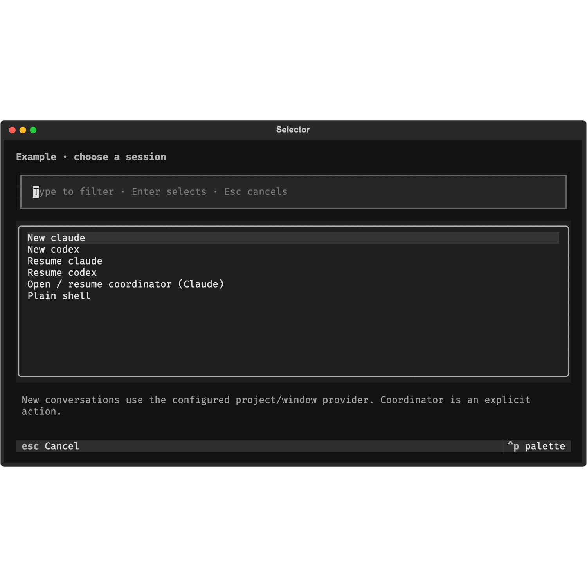

# How the utilities work

A rendered menu using synthetic project data:



## Script and module map

| File | Responsibility |
| --- | --- |
| `agent_utils/entry.py` | The `agents` command: context detection, group routing, bare-run menus. |
| `agent_utils/cli.py` | The flat `agents agterm` parser (also `agents admin project|settings|inbox`), provider argv, targeted agterm calls, bootstrap, worktrees, coordinator and desktop handoff. |
| `agent_utils/core/agents.py` | Supported provider CLIs and how their executables are found. |
| `agent_utils/core/paths.py`, `files.py` | External config/state/data locations with the one-time copy from `agterm-utils`; atomic JSON writes. |
| `agent_utils/core/settings.py` | `agents admin config` and `agents configure`: settings registry, owned-elsewhere rows, actions, menu. |
| `agent_utils/core/setup/` | Importable setup modules behind `scripts/install.py` and `scripts/configure-*.py`: `installer`, `kiro`, `relay`, `session_names`, `zsh`, `startup`, `optional`. |
| `agent_utils/core/skills.py`, `skillcheck.py`, `audit.py` | `agents admin skills`: store and links, drift check and schedule, project instruction audit. |
| `agent_utils/core/instructions.py`, `snippets.py`, `snippet_library/` | `agents admin instructions` and `compose`: shared rule sources, per-agent targets, snippets. |
| `agent_utils/core/ask.py` | `agents agent ask`: read-only parallel consults with per-agent adapters and guards. |
| `agent_utils/core/notify.py` | ntfy notifications (`agents agent|admin notify`). |
| `agent_utils/agterm/startup.py` | Session chooser: project from actual workspace membership or folder, provider and session menus, in-place exec or plain-shell fallback. |
| `agent_utils/agterm/configuration.py` | Locked project add/edit/enable/disable/move/order and provider settings, with validation and backups. |
| `agent_utils/agterm/sessions.py`, `state.py` | Managed launch records, task worktrees, exact resume/bind, local lifecycle, results and notifications; registry lock and atomic writes. |
| `agent_utils/agterm/workers.py` | Worker identity, live probes, serialized `ensure` dispatch, task links. |
| `agent_utils/agterm/runner.py` | Process wrapper that records PID/start identity and exit code, and swaps in the resume command on a Live replay. |
| `agent_utils/agterm/restore.py` | Restart commands (pins), conversation id discovery, snapshots and plans. |
| `agent_utils/agterm/history.py` | Project-scoped Codex metadata API and bounded Claude JSONL metadata reads; adoption. |
| `agent_utils/agterm/placement.py` | Move new rows to the top once by exact ID; bootstrap baselines existing rows. |
| `agent_utils/agterm/coordinator_gate.py` | `PreToolUse` gate passed only to the coordinator Claude process. |
| `agent_utils/agterm/names.py`, `kiro_hook.py` | `agents agent rename|sync` and the name hooks; Kiro attention and Inbox hooks. |
| `agent_utils/agterm/remote.py`, `mobile.py` | `agents remote`: SSH shell, native attach, terminal-only attach; `agents mobile` JSON-lines helper. |
| `agent_utils/agterm/tui.py`, `dashboard.py`, `cheatsheet.py` | Optional Textual selector; session snapshot dashboard; hotkey cheatsheet. |
| `agent_utils/plannotator/` | Inbox doctor, thread listing and dispatch, launch adoption (`inbox.py`), file edits (`state.py`), Kiro reply relay (`relay.py`). |
| `scripts/install.py`, `scripts/brew-local.py`, `scripts/release.py` | Preview/install/update/rollback; local-only Homebrew build; GitHub release plus the tap formula. |
| `scripts/configure-*.py` | Thin wrappers over `agent_utils/core/setup`. `configure-startup.py` is the older direct-command route and refuses Live mode. |
| `agent_utils/core/setup/agterm-startup.zsh` | First interactive prompt enters the session chooser once; skips ordinary terminals, noninteractive commands and Zellij. |
| `scripts/optional/shell-example.sh` | Optional shell/multiplexer example; not installed automatically. |
| `skills/` | Skills installed through `agents admin skills add`; `agterm-workflows` is a draft, not installed. |

The user-facing documentation is in [docs/guide](../guide/README.md) and
[docs/reference](../reference/README.md); this page explains internals.

## Installation and configuration changes

The installer replaces only the package and the two wrappers under `~/.bin` and
writes a manifest/backups below `~/.bin/agterm-tools`. `--with-tui` installs pinned
Textual in `~/.bin/agterm-tools/runtime`; wrappers select that interpreter. No
system Python packages are modified. Code rollback restores wrappers/package,
not runtime dependency versions or external configuration.

Startup is separate and opt-in. `configure-zsh.py --apply` backs up `.zshrc` and
adds a managed source block plus `agterm-startup.zsh` under the helpers directory.
It removes only the older managed direct-command block if present. It does not
change Live mode. To undo startup, remove the managed source block or restore its
backup. Existing shells need a fresh session to load changes.

Explicit utility launches carry `AGTERM_UTILS_PLAIN_SHELL=1`, preventing the zsh
menu from intercepting their command. Startup-selected providers replace the menu
process in the same terminal; regular CLI launches create a targeted new row.
Native Codex launches add `--no-daemon` so status hooks inherit that terminal's
identity instead of another terminal's shared daemon. Normal auth/permissions and
user/project settings remain provider-owned; extra arguments come from config.

The external config is `~/.config/agent-utils/config.json` (or XDG_CONFIG_HOME).
A project has a unique ID, workspace name, ordered roots and optional provider
arguments/default. Window defaults need not be named Work/Personal: names are
arbitrary. The project default overrides the window default. Example:

```json
{
  "version": 1,
  "new_session_position": "top",
  "windows": [
    {"name": "Work", "default_agent": "claude", "projects": [
      {"id": "example", "name": "Example", "roots": ["~/Projects/example"]}
    ]},
    {"name": "Personal", "default_agent": "codex", "projects": []}
  ],
  "remotes": [{"name": "Development Mac", "host": "dev-mac"}]
}
```

## New-session placement

Top-level `"new_session_position": "top"` in the existing external config enables
post-creation movement; omitted or `"default"` leaves placement unchanged. Utility
launches move the exact returned row ID. The ordinary +/Cmd-N startup hook uses
`AGTERM_SESSION_ID` and `AGTERM_WINDOW_ID`, never the active selection. Movement
is `agtermctl session move --to top` with explicit target/window/socket.

Run `agents agterm bootstrap` once after enabling it: existing rows are recorded
without being moved. External `placement.json` stores handled IDs under a separate
lock from conversation state. A restored/revisited ID won't move again. Without
that bootstrap baseline, an existing row first seen by the hook can move once.
A row restored from a previously closed/unbaselined window can also move once;
the utility cannot identify every never-seen restored row as old.
Future utility launches and hooked new shells read the setting immediately; no
agterm preference or restart is needed. Explicit external launches that bypass the
utility/hook aren't covered. A move failure reports the already-open row and does
not retry the agent launch. Disable with `"default"`; previous row order is retained.

## Add a project and send it to agterm

```sh
agents admin project add --project example --name Example \
  --window Work --agent claude --root ~/Projects/example --send
```

`add` creates a missing window configuration only with an explicit `--agent`.
Repeat `--root` for additional roots. On `edit`, `--root` replaces the whole list; `--add-root` and `--remove-root` change one root. The config is locked, validated and backed
up before replacement. `--send` runs targeted bootstrap for that ID: create a
missing window/workspace, reuse existing uniquely named ones and start no model.
Then use +/Cmd-N with the startup hook, or `agents agterm menu --project example`.
If agterm is unavailable, the saved config remains and bootstrap can be retried.

```sh
agents admin project edit --project example --agent codex
agents admin project order --project example --position 1
agents admin project move --project example --window Personal
agents admin project disable --project example
agents admin project enable --project example --send
```

Editing/moving configuration does not relocate existing live sessions. Rename or
move rows using agterm itself when wanted; the utility does not discard the old
workspace. Config-file editing works too: validate, then targeted bootstrap.

```sh
agents agterm validate
agents agterm --dry-run bootstrap --project example
agents agterm bootstrap --project example
```

## Storage: terminal processes, transcripts and task records

These are three different layers:

| Layer | Owner and persistence |
| --- | --- |
| Windows/workspaces/terminal rows | agterm saves its own layout and restore state. Live mode keeps primary/split processes in its bundled zmx daemons. The utility does not copy or rewrite those snapshots. |
| Claude/Codex conversations | Each provider owns its normal home, authentication, transcript/history and resume behavior. Nothing is converted between providers. |
| Utility configuration/registry/worktrees | JSON config under XDG_CONFIG_HOME; locked `registry.json` under XDG_STATE_HOME (`~/.local/state/agent-utils` by default); default task worktrees below its `worktrees/` directory. |

A managed record contains its own UUID, project ID, provider, title, roots, terminal
row ID, optional provider conversation ID, timestamps, lifecycle flags and explicit
result. `AGTERM_UTILS_RECORD` is inherited by the provider and its tools. Sidebar
info shows the record ID. Claude new sessions use a preallocated conversation UUID;
Codex new sessions initially have no known provider ID. Bind the actual UUID with
`session bind`, or discover/adopt it through `history`. Never infer identity from
similar titles, cwd or near-identical timestamps.

A coordinator has a separate project registration in the same registry. Existing
row: focus it. Missing row: reuse the saved conversation ID, with duplicate-process
guards. It never silently allocates a replacement UUID after initialization fails.
The coordinator is Claude-only; an ordinary Codex conversation works in Personal.

Task launches validate every selected repository, then create one task branch and
worktree per repo. The generated default parent uses a stable hash of project ID,
plus the task branch path. Agent cwd/additional roots are the worktrees. Original
project roots/configuration stay unchanged. Multi-repo creation is not atomic: a
partial failure preserves created worktrees for inspection and manual recovery.

## History and lifecycle semantics

`session archive/hide` only changes utility flags. `unarchive/unhide` reverses them.
The live agterm row and provider transcript stay intact. `forget --yes` drops only
utility metadata. `session resume` first focuses an existing row; if absent, exact
provider identity and explicit `--backend-stopped` are required to launch a resume.
A closed row alone is not proof that its Live backend stopped.

`history` collects cwd-filtered provider metadata. Codex uses `app-server --stdio`
with initialize and `thread/list`, exact cwd filters, bounded pages and state-DB-only
reads; it never sends a model turn. Claude examines bounded local JSONL metadata
headers and accepts only an actual matching cwd/session ID. Older/changed provider
formats can be unavailable rather than guessed. `--adopt UUID` creates a utility
record, not a provider copy. Discovery includes known managed task roots; unrelated
unregistered worktrees are not automatically attributed to a project.

Explicit Codex `session provider-archive/provider-unarchive/provider-delete` invokes
the native CLI against the bound UUID; archive/delete require the provider stopped,
`--yes`, and no open recorded row. Utility lifecycle remains separate. Claude lacks
matching individual archive/delete commands; project-wide purge is not used.

`gui` delegates to `codex app PATH` or `claude --desktop [--resume UUID]`. This opens
the provider UI; it does not establish Codex GUI project membership/settings parity.

## Status, results and review

Use agterm's **Help → Install Agent Status Hooks** for native turn status. The
utilities don't replace those adapters. Their live tree status is used in the
snapshot dashboard. Provider tints mark identity; glyphs show native status.
Managed recency is based on utility updates, not an invented last-activity clock.

Explicit task completion is separate:

```sh
agents agterm session status --record RECORD_ID --state running
agents agterm session finish --record RECORD_ID --result 'Implemented; checks passed'
# For a failed task:
agents agterm session finish --record RECORD_ID --failed --result 'Blocked by missing API'
```

A result is saved before notification. If its terminal no longer exists, it remains
in the registry. With an open row, the utility posts native status/notification;
with an open coordinator for the project, it notifies that row too. There is no
daemon inferring completion from an idle agent, no automatic retry loop and no
unattended review. Request review through the existing provider review skills.

## Remote sessions and optional terminal behavior

`agents remote shell` runs ordinary SSH using normal SSH configuration. Native Mac-to-Mac
attachment reads `agtermctl zmx tree HOST`, filters the returned exact IDs and calls
`zmx attach HOST ID`; agterm revalidates the origin and bundled endpoint. It owns
reconnect, split presentation, resize and leadership. Attach with `--companions`
when wanted. `--window` and `--project` filter origin names; `--destination-window`
selects the local destination ID. `agents remote detach` closes only a verified remote
client row, leaving the origin running. Remote rows aren't persisted for relaunch.

For phone/Termius, run `agents` in an interactive SSH shell on the origin Mac;
SSH detection selects local terminal mode. `agents remote terminal` selects it explicitly,
and `ssh -t dev-mac 'agents remote terminal'` connects from another terminal.
An exact `--session` and optional `--pane left|right` skip the corresponding picker.
After selection, it re-reads local Live inventory, verifies the same endpoint and
daemon, and invokes the endpoint's bundled `zmx get NAME` immediately before
`zmx attach NAME`. `ZMX_DIR` comes from that endpoint; inherited zmx names, prefixes,
managed-client variables and agterm target IDs are removed from the attach client's
environment. The origin process is not restarted.

Ctrl+\ detaches the current client only; `zmx detach` would detach all clients and
is not used. A TTY is required. One pane is attached per connection; use separate
connections for splits/companions. GUI presentation and native Mac leadership
controls are not implemented by raw terminal mode. Input/resize follow bundled
zmx behavior, which needs simultaneous-client acceptance testing.

**Accepted race:** zmx lacks existing-only attach. A daemon can disappear between
the immediate existence check and attach, causing a replacement daemon to be
created. Changed/missing targets before the check are refused; this does not make
attachment atomic. No extra daemon or global terminal profile is installed.
Zellij/Termius bindings and mc Ctrl-S behavior remain optional shell/client choices.
The native view-only grid is already provided by `agtermctl dashboard --mru`.

## Screenshot paste, restore and closed lid: what should already work

- **Screenshot paste:** no utility script is involved. The agent runs directly in
  the terminal with its normal clipboard handling. Use the provider's paste-image
  shortcut and inspect its attachment preview. macOS permission denials and image
  handling over SSH are not bypassed. Saved image paths use ordinary provider input.
- **Live restoration:** the opt-in zsh hook keeps zsh configured for Live eligibility;
  explicit launches set the menu-bypass environment flag. agterm/zmx stores and
  reattaches processes. No utility snapshot daemon or restore-mode change is added.
- **Moved sessions:** startup reads actual session membership from agterm's tree,
  ahead of inherited workspace IDs/cwd.
- **Closed lid:** no power snippet is installed. macOS clamshell requirements and
  hardware/power conditions decide continued operation. `caffeinate` alone isn't
  treated as a promise of lid-closed runtime.

## Input checking: shell syntax versus spelling in prompts

**Shell commands:** [zsh-syntax-highlighting](https://github.com/zsh-users/zsh-syntax-highlighting)
colors command syntax while typing in zsh. It does not inspect a running agent's
prompt editor. Optional setup, not applied automatically:

```sh
brew install zsh-syntax-highlighting
# Put this at the end of .zshrc, after other ZLE widgets:
[[ -r /opt/homebrew/share/zsh-syntax-highlighting/zsh-syntax-highlighting.zsh ]] && \
  source /opt/homebrew/share/zsh-syntax-highlighting/zsh-syntax-highlighting.zsh
```

Use the correct Homebrew prefix on another Mac. It highlights command syntax and
unrecognized commands; it is not a complete semantic shell validator.

**Claude prompt spelling:** Claude Code 2.1.235+ supports underlines as you type,
using local aspell/hunspell/ispell. Install a checker and dictionary, then merge
this key into user `~/.claude/settings.json` (preserve other keys):

```json
{"spellcheck": {"enabled": true}}
```

Alternatively pass a separate JSON file through `claude --settings FILE` for one
session. The setting is not accepted from project settings. It checks prompt text,
not grammar, model replies or source files. Reference:
[Claude input spelling](https://code.claude.com/docs/en/interactive-mode#check-spelling-as-you-type).
Type a misspelling plus a space and check the underline without sending a message.
No dictionary installation or provider settings change is part of this rollout.

**Codex prompt spelling/grammar:** no equivalent supported setting was found in
its current config schema. Its external-editor action opens the draft in
`$VISUAL`/`$EDITOR`; use an editor with its own spelling/grammar support, save and
return, or draft elsewhere and paste. This is a provider/editor capability, not an
agterm-wide spellchecker. Relevant sources:
[Codex schema](https://github.com/openai/codex/blob/main/codex-rs/core/config.schema.json),
[Codex input actions](https://github.com/openai/codex/blob/main/codex-rs/tui/src/keymap.rs).

**Code errors:** normal editor/LSP/linter integration remains in the editor. agterm
renders its diagnostics; the utility doesn't lint arbitrary prompt text as code.
